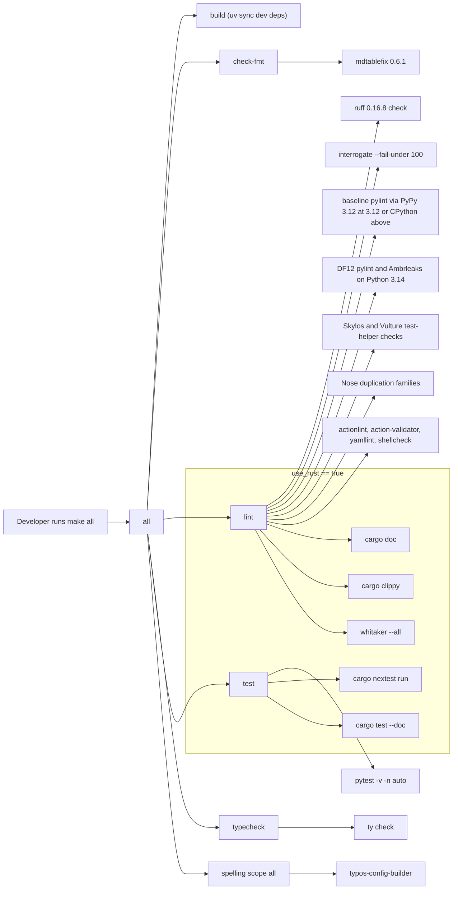

# Generic Copier Template

This repository provides a [Copier](https://copier.readthedocs.io/) template
for a Python package. It offers two flavours:

1. **Python Only** – a pure Python implementation.
2. **Python with Rust** – includes a PyO3 extension.

Python 3.12 is the minimum supported baseline.

Run `copier copy` and answer the prompts to generate a project.

## Running Tests

The test suite relies on the `pytest-copier` plugin and renders generated
projects that run Ruff, `ty`, baseline Pylint (on PyPy 3.12 when the baseline
is 3.12, otherwise on CPython at the baseline), and the isolated Python 3.14
DF12 Python Lints v0.4.0 lint, dead-code, and duplication gates. Generated
linting also checks test helpers with Ambrleaks, Skylos, and Vulture, validates
GitHub Actions and shell sources, and runs Interrogate as a 100% docstring-
coverage gate. Rust projects also run Clippy, Whitaker, and nextest-aware Rust
tests.

Run the parent template tests through the repository `Makefile`. Run
`make help` to list the available parent Makefile targets. Parent gates include
`make check-fmt`, `make lint`, `make typecheck`, and `make test`. The `test`
target uses `uvx` to provide `pytest-copier`, `pyyaml`, `syrupy`, and
`make-parser` without a manually managed virtual environment:

```bash
make test
```

Run `make test WITH_ACT=1` to include the act-backed workflow integration tests
when `act` and Docker are available. Parent repository CI runs this mode in a
separate act-validation workflow so rendered in-template GitHub workflows do
not hold up the normal template test workflow.

Generated projects install and run their own tooling. The baseline Python
version is the selected `python_version` and cannot be lower than 3.12. Ruff
0.16.8 and `ty` 0.0.56 run in isolated tools; baseline Pylint 4.0.9 uses PyPy
3.12 for a 3.12 baseline and CPython at the baseline for newer versions. The
DF12 Python Lints v0.4.0, Ambrleaks, Skylos, Vulture, and the duplication
detector use an isolated Python 3.14 tool environment. `make markdownlint`
checks Markdown and repository-wide spelling; action linting validates
workflows and local actions with actionlint, action-validator, yamllint, and
shellcheck. Rust projects also run Clippy, Whitaker, and nextest.

You can also run `scripts/setup_test_deps.sh` to install parent test
dependencies into the current Python environment manually.

## Generated Quality Gate Flow

Figure: The generated `make all` quality gate runs build, formatting, linting,
typechecking, and testing. Rust-specific lint and test branches run only when
the Rust extension is enabled. The `audit` target checks Python dependencies via
`pip-audit` and, when Rust is enabled, Rust dependencies via `cargo audit`.



Run `make audit` separately to check Python dependencies with `pip-audit` and,
when Rust is enabled, Rust dependencies with `cargo audit`.
