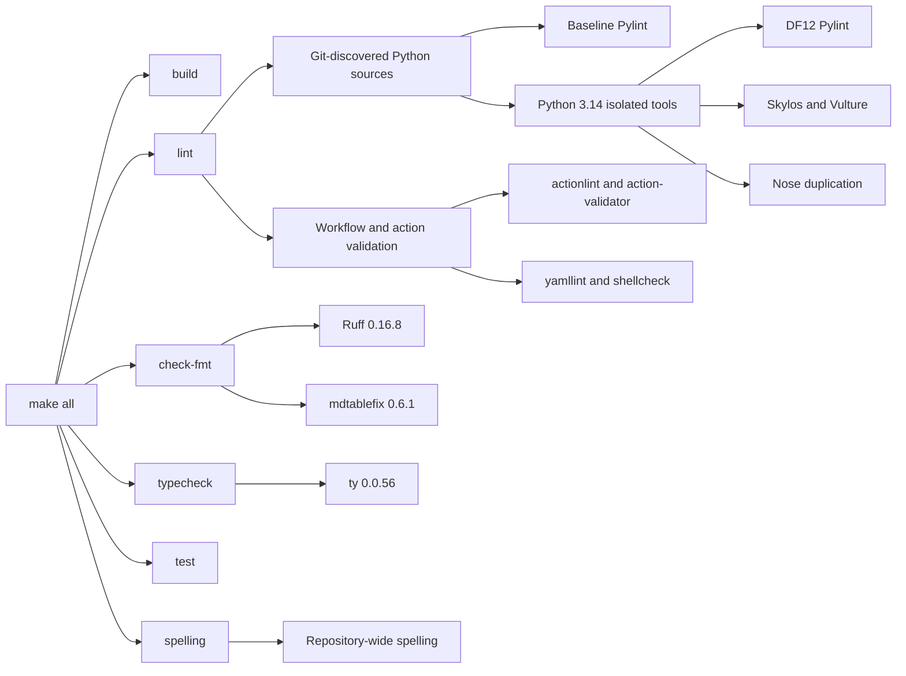

# Users' guide

## Generated project quality gates

The diagram below summarizes the quality gates in projects generated by this
template. Run `make all` in a generated project to build the code, check
formatting, run linters and typechecking, execute tests, and check spelling.
Before the first quality-gate run, initialize Git at the generated project root
with `git init`. Python source discovery and Markdown table formatting use Git
repository metadata.

For existing generated projects, see the
[Python 3.12 migration guide](migrating-to-python-3.12.md) before updating the
template.

Figure 1: Generated project quality-gate flow, read from left to right.
`make all` runs build, formatting, lint, type, test, and spelling gates.
Linting covers Git-discovered Python sources with baseline Pylint and isolated
Python 3.14 tools for DF12 linting, dead-code detection, and duplication
checks. It also validates workflows, actions, YAML, and shell code. Formatting
uses Ruff and mdtablefix; typechecking uses ty; spelling covers the whole
repository. Baseline Pylint uses PyPy for Python 3.12 and CPython for newer
baselines.

